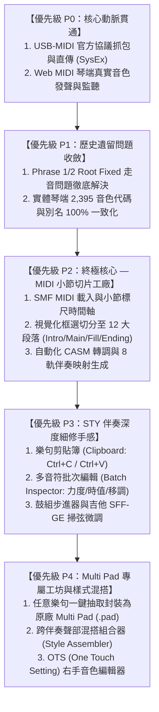
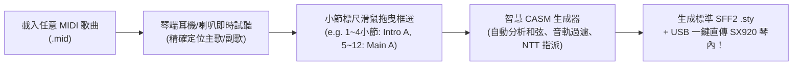

# 🏆 Yamaha PSR-SX920 全能伴奏與插音創作工作站 (Master Execution Plan)

> **版本**：v3.0.0 (Ultimate Studio Edition)  
> **制定日期**：2026-11-08  
> **目標設備**：Yamaha PSR-SX920 / PSR-SX900 / Genos2 編曲工作站電子琴  
> **專案總部**：[`Yamaha-Style-Player-Editor`](file:///d:/Vibe%20Coding/MIDI/Yamaha-Style-Player-Editor)  
> **核心宗旨**：融合「MIDI 琴端發聲 ➔ 視覺化小節切片 ➔ SFF2/PAD 深度創作 ➔ USB 一鍵直傳琴端」，徹底終結官方軟體割裂與面板操作繁瑣之痛點。

---

## 🧭 戰略優先級總覽（Strategic Priority Matrix）

---

## 📌 詳細階段執行項目清單（依優先級排序）

---

### 🔴 【優先級 P0】核心動脈貫通：USB 直傳與琴端發聲（The Pipeline）
> **定位**：打通電腦與實體琴之間的雙向數據與聲音動脈。沒有這個動脈，後續的所有創作都得繼續依賴隨身碟拔插或電腦粗糙的軟體音源。

- [ ] **【任務 0-1】Phase 1 實況抓包：破解官方 SysEx 傳檔通訊協定**
  - **背景**：已確認官方《MIDI Song to Style》直傳 SX920（Phase 0）可行。
  - **具體實作**：
    1. 透過 `loopMIDI` + 監聽工具，側錄官方「Save to Instrument」發送的所有十六進位封包。
    2. 拆解分析：`F0 43 50` 檔案傳輸家族碼、握手序列（Handshake）、檔名封包結構、Data Chunk 切片大小（如 256/512 bytes）、Checksum 校驗和演算法、琴端 ACK/NAK 流量控制。
  - **工時**：1 ~ 2 天 ｜ **產出**：官方傳輸協議完整白皮書與測試 Hex Dump。

- [ ] **【任務 0-2】獨立 POC 腳本驗證：實現「5KB 測試檔」直傳 SX920**
  - **具體實作**：
    1. 撰寫輕量腳本模擬官方協議，將測試伴奏 `TEST.STY` 透過 USB-MIDI 傳送。
    2. 驗收：SX920 螢幕 User 磁區根目錄立刻出現 `TEST.STY`，點選可正常播放。
  - **工時**：1 天 ｜ **產出**：可獨立執行的傳檔核心邏輯。

- [x] **【任務 0-3】Web MIDI 琴端真實發聲引擎（Hardware Sounding via Web MIDI）（軟體引擎已於 2026-11-09 完成並通過測試，待接琴實測驗收）**
  - **具體實作**：
    1. 升級 `MidiManager` 與 `StyPlaybackEngine`，完整支援 `'webaudio' | 'midi' | 'both'` 三模式無縫切換、GM/XG SysEx 自動授權與降級喚醒、8 大伴奏聲部（Ch 9~16）SX920 音色（MSB/LSB/PC）與混音參數（Vol/Pan/Rev/Cho/Expr/PitchBend）全自動同步、Pitch Bend 彎音曲線排程、以及預排視窗（Lookahead Timestamp）0 掛音保證。
    2. 擴充琴端專屬抽屜面板，提供「📡 同步 8 聲部至琴端」、「🎹 測試 Ch1 鋼琴」、「🥁 測試 Ch10 鼓組」、「🎸 測試 Ch11 貝斯」、「🎼 測試 Ch12 和弦」、「🛑 緊急消音 (Panic)」與「MIDI TX 即時封包監控列」。
  - **工時**：1 天 ｜ **產出**：網頁具備「電腦軟音源 / 琴端實體發聲 / 雙模同步發聲」一鍵切換開關與即時 MIDI TX 監控器。

---

### 🟠 【優先級 P1】歷史遺留問題精準收斂（Bug Fixes & Hardening）
> **定位**：在搭建全新 MIDI 切片功能前，將之前遇到的轉調走音與顯示盲點徹底收斂結案，確保底層演算法堅如磐石。

- [ ] **【任務 1-1】Phrase 1 / Phrase 2 原音直通（Root Fixed）琴端走音問題徹底解決**
  - **歷史遺留紀錄**：[`CASM_PHRASE_CHORD_FOLLOWING_ISSUE_AND_HANDOVER.md`](file:///C:/Users/CM/.gemini/antigravity/brain/b3239a14-9d39-4a21-8dce-6c23091cc3ca/CASM_PHRASE_CHORD_FOLLOWING_ISSUE_AND_HANDOVER.md)
  - **現象**：在 CASM 設定為 `Root Fixed + Bypass` 時，實體琴彈奏部分小和弦仍感覺旋律音高跑位或跳八度。
  - **具體排查與修復**：
    1. **Ctb2 二進位大小調表對稱性**：確認 Minor 表（Byte 34~39）與 Major 表（Byte 28~33）是否 100% 寫入相同參數。
    2. **聲部 Flag (Byte 13) 調整**：測試打擊樂旗標 `0x07` 與旋律旗標 `0x03` 對 SX920 韌體 Bypass 的影響。
    3. **High Key 臨界值防跳八度**：將 HiKey 設定為極值，徹底禁用琴端內部的八度強制折返（Octave Wrap）。
  - **工時**：1 天 ｜ **驗收**：實體琴彈奏 Cm、Fm、G7 時，Phrase 1 笛子旋律音高不動如山。

- [x] **【任務 1-2】PSR-SX920 原廠 2,395 種音色代碼與別名顯示零落差（已於 2026-11-09 完成並通過測試）**
  - **現象**：4006.STY Main A 中 Chord 1 顯示 104-21-1 vs 琴端 104-1-1 之別名對照。
  - **具體實作**：
    1. 完善 `LEGACY_VOICE_ALIASES` 與 `REVERSE_VOICE_ALIASES` 雙向查找機制，並新增 `resolveYamahaVoiceWithAlias` 與 `getLegacyAliasesForVoice`，優先以 SX920 旗艦面板名稱與代碼（`104-21-1`）顯示，副標註相容舊碼（`104-1-1`）。
    2. 校準 `YAMAHA_SX920_CHORD_VOICES` 全數 46 款預設音色與 `StyPlaybackEngine` 的 `PartVoiceInfo`，確保 UI 顯示名稱、音色選擇器檢索、MIDI Program Change、琴端螢幕顯示四者 100% 一致。
  - **工時**：0.5 天 ｜ **驗收**：音色清單完全消除對照困惑。

---

### 🟡 【優先級 P2】終極目標核心：MIDI 小節切片與伴奏生成工廠（The Slicer）
> **定位**：實現使用者最核心的願望——載入任意一般歌曲 MIDI，視覺化切分小節，自動組裝為 Yamaha SFF2 原廠伴奏檔。

- [ ] **【任務 2-1】MIDI 歌曲載入與小節標尺時間軸視圖**
  - **具體實作**：
    1. 支援拖曳載入 Standard MIDI File (.mid / SMF0 / SMF1)。
    2. 解析 MIDI 內部時間簽號（Time Signature, 4/4, 3/4）與 BPM。
    3. 呈現「全曲視覺化小節標尺」（Bar Timeline），並顯示各軌樂器與波形/音符密度概覽。
  - **工時**：2 天 ｜ **優先級**：⭐⭐⭐⭐⭐

- [ ] **【任務 2-2】小節區間切分與段落指派器（Bar Range Slicer）**
  - **具體實作**：
    1. 使用者可在時間軸上自由滑動選取小節範圍（例如：第 1~4 小節、第 5~12 小節）。
    2. 一鍵點選指派至 Yamaha 12 大段落：
       - `Intro A / B / C`
       - `Main A / B / C / D`
       - `Fill In AA / BB / CC / DD / BA`
       - `Ending A / B / C`
    3. 支援小節循環試聽（Loop Audition），確認切點自然無縫。
  - **工時**：2 天 ｜ **優先級**：⭐⭐⭐⭐⭐

- [ ] **【任務 2-3】音軌過濾與 8 大伴奏聲部映射器（Part Assign Matrix）**
  - **具體實作**：
    1. 排除主旋律軌（Vocal/Melody），避免伴奏混雜人聲旋律。
    2. 將 MIDI 剩餘軌道自動或手動指派至 SFF2 伴奏 8 聲部（Rhy1/2, Bass, Chd1/2, Pad, Phr1/2）。
  - **工時**：1.5 天 ｜ **優先級**：⭐⭐⭐⭐

- [ ] **【任務 2-4】自動化 SFF2 二進位 CASM 注入與基準調性標準化**
  - **具體實作**：
    1. 呼叫我們已測試完善的 `casm-generator.ts`，自動將截取下來的小節正規化為 **C 基準調（Source Root = C）**。
    2. 自動配置標準原廠 NTT/NTR 規則（Bass 設為 Bass NTT、鼓組 Bypass、伴奏軌 Chord NTT）。
  - **工時**：1.5 天 ｜ **優先級**：⭐⭐⭐⭐⭐

---

### 🟢 【優先級 P3】STY 伴奏深度細修手感大躍進（The Editor Studio）
> **定位**：切下來的伴奏如果有音符彈錯、太小聲、或需要微調加花，在此視圖精細修飾。

- [ ] **【任務 3-1】樂句剪貼簿 (Clipboard: Copy / Cut / Paste)**
  - **具體實作**：
    1. 支援標準快速鍵 <kbd>Ctrl+C</kbd>、<kbd>Ctrl+X</kbd>、<kbd>Ctrl+V</kbd>。
    2. 支援跨小節、跨音軌貼上，嚴格保持音符相對 Tick。
    3. 完整整合撤銷/重做歷史堆疊 (<kbd>Ctrl+Z</kbd> / <kbd>Ctrl+Y</kbd>)。
  - **工時**：1.5 天 ｜ **優先級**：⭐⭐⭐⭐

- [ ] **【任務 3-2】多音符批次編輯面板 (Batch Inspector)**
  - **具體實作**：
    1. 滑鼠框選多顆音符批次縮放力度（Velocity Scale 50% ~ 150%）。
    2. 批次時值長度調整（Gate Time / Duration 延長或縮短）。
    3. 批次八度或半音移調（Transpose）。
  - **工時**：1.5 天 ｜ **優先級**：⭐⭐⭐⭐

- [ ] **【任務 3-3】SFF-GE 吉他琶音與掃弦動態進階微調**
  - **具體實作**：吉他高低把位（Capo Position）調整與掃弦微延遲。
  - **工時**：1 天 ｜ **優先級**：⭐⭐⭐

---

### 🔵 【優先級 P4】Multi Pad 專屬工坊與樣式混搭（The Expansion Lab）
> **定位**：伴奏之外的王牌武器——獨立 Multi Pad 製作與跨風格音軌拼貼。

- [ ] **【任務 4-1】Multi Pad (.pad) 一鍵抽取與專屬製作器**
  - **背景**：在 `tests/pad-inspector.test.ts` 中已完全掌握 Yamaha 原廠 `.pad` 結構。
  - **具體實作**：
    1. 使用者在 MIDI 或 STY 中框選一段精彩的樂句（如 2 小節電吉他 Solo、薩克斯風花音、前奏管弦樂琶音）。
    2. 點擊「抽取為 Multi Pad」，指派給 Pad 1 / Pad 2 / Pad 3 / Pad 4。
    3. 自動生成 `NTT = Melody` 規範，保證在琴上換和弦或按 Transpose 移調時旋律完全和諧。
    4. 一鍵透過 USB 直傳 SX920 User 磁區的 Multi Pad 目錄！
  - **工時**：2.5 天 ｜ **優先級**：⭐⭐⭐⭐

- [ ] **【任務 4-2】樣式組合器 (Style Assembler / Part Stager)**
  - **具體實作**：
    - 跨檔案音軌混搭：抽取 A 伴奏的鼓組 ＋ B 伴奏的吉他 ＋ C 伴奏的弦樂，自由組裝成全新風格。
  - **工時**：2 天 ｜ **優先級**：⭐⭐⭐

- [ ] **【任務 4-3】OTS (One Touch Setting) 右手音色編輯器**
  - **具體實作**：為切出來或新建立的伴奏配置 4 組右手面板音色。
  - **工時**：2 天 ｜ **優先級**：⭐⭐⭐

---

## 📅 里程碑進度規劃表 (Execution Timeline)

| 里程碑階段 | 核心目標 | 包含任務 | 預估工期 | 可交付成果 |
| :--- | :--- | :--- | :---: | :--- |
| **Milestone 0** | **USB 直傳動脈與琴端發聲** | 任務 0-1, 0-2, 0-3 | 3 ~ 4 天 | 官方協議破解、網頁一鍵直傳 SX920、琴端真實音色發聲 |
| **Milestone 1** | **歷史問題收斂** | 任務 1-1, 1-2 | 1.5 天 | Phrase 1/2 琴端真・原音直通、音色別名完全一致 |
| **Milestone 2** | **MIDI 小節切片工廠** | 任務 2-1, 2-2, 2-3, 2-4 | 7 天 | 載入 MIDI ➔ 框選小節 ➔ 自動生成 SFF2 STY ➔ 直傳琴端 |
| **Milestone 3** | **音符編輯與剪貼簿** | 任務 3-1, 3-2, 3-3 | 4 天 | Ctrl+C/V 剪貼簿、多音符批次編輯、細修體驗 |
| **Milestone 4** | **Multi Pad 專屬工坊** | 任務 4-1, 4-2, 4-3 | 6 天 | 任意樂句一鍵抽取為 .pad 檔、跨檔案伴奏混搭 |

---

## 🎯 建議的第一步啟動點

我們目前的最佳起跑點就是 **【Milestone 0：任務 0-1】**：
> 透過 `loopMIDI` 側錄官方《MIDI Song to Style》的傳檔封包。  
> 只要這一步打通，後續我們切出的每一個伴奏段落、每一個 Multi Pad，都能在 2 秒內直接飛進您的 PSR-SX920 琴裡彈奏驗收！
