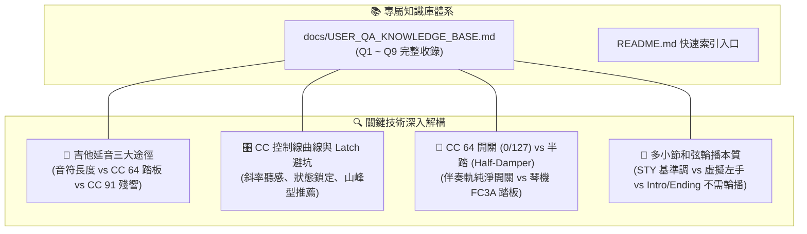

# Yamaha Style Player & Editor 工作成果與跨帳號無縫接軌指南

**紀錄日期**：2026-11-03  
**適用琴型**：Yamaha PSR-SX920 / PSR-SX900 / Genos / Tyros 系列伴奏檔（SFF1 / SFF2）  
**專案儲存庫**：[`Yamaha-Style-Player-Editor`](file:///D:/Vibe%20Coding/Yamaha-Style-Player-Editor)  
**GitHub 雲端**：👉 [https://github.com/CMChen59/Yamaha-Style-Player-Editor](https://github.com/CMChen59/Yamaha-Style-Player-Editor)  
**目前分支**：`main`  
**自動化測試**：**102 個測試套件、487 項測試 100% 綠燈通過 (ALL PASS)**  
**今日核心產出**：**使用者常見問答知識庫手冊（Q1~Q9）建立與全套技術深度剖析**

---

## 一、 今日核心進展與技術沉澱

今日重點在於伴奏編輯實戰應用層面的深度解構、使用指南建立，以及 Yamaha 伴奏機制的深入解析：



### 1. 建立專屬知識庫手冊（`docs/USER_QA_KNOWLEDGE_BASE.md`）
- 在專案內正式建立了分類清晰、具備錨點跳轉與維護擴充性之問答知識庫，並在 `README.md` 首頁建立導覽入口。
- **已收錄 9 大經典主題**：
  - **Q1**：如何增加特定聲部（《容易受傷的女人》吉他 Chord 1）延音？（軟體與 SX920 操作對照）
  - **Q2**：為什麼轉到小調會出現 G# 導音衝突？（小調調和演算法解析）
  - **Q3**：為什麼吉他琶音軌音符會亂飄？（SFF-GE 全八度模數琴弦解譯矩陣）
  - **Q4**：軟體端轉調優化會影響匯出的 STY 二進位檔嗎？（純軟體監聽層隔離保證）
  - **Q5**：混音卡片 Reverb (CC 91) 與 Chorus (CC 93) 怎麼快速重設為原廠預設值？（雙擊快速重設）
  - **Q6**：單軌編輯器 CC 控制線拉斜線的效果如何？（MIDI Latch 狀態鎖定與 3 種推薦畫法）
  - **Q7**：Sustain (CC 64) 只有 0 和 127 嗎？（Switch 規則 vs PSR-SX920 半踏 Half-Damper 特性）
  - **Q8**：多小節和弦輪播小節數與內容是怎麼決定的？（小節同步 vs STY C 基準調與虛擬左手）
  - **Q9**：在 Intro 或 Ending 段落中需要開啟多小節輪播嗎？（原曲前奏旋律保護與終止式收尾原則）

---

## 二、 跨帳號無縫接軌指南（切換新帳號後之 Resume 步驟）

當您切換到不同帳號（或新電腦/會話）後，請按以下步驟無縫接棒：

### 步驟 1：確認與拉取 GitHub 最新進度
在終端機中切換至專案路徑並拉取最新備份：
```bash
cd "D:\Vibe Coding\Yamaha-Style-Player-Editor"
git pull origin main
git status
```
*(確認 Commit 與遠端同步，Working Tree Clean)*

### 步驟 2：執行全套單元測試驗證
```bash
npx vitest run
```
*(確認 102 個測試套件、487 項測試 100% 綠燈通過)*

### 步驟 3：喚醒 AI 助手的 Prompt（直接複製給新帳號的 AI）
切換帳號後，直接向新對話發送以下指令即可立即進入狀況：
> 「我們正在進行 Yamaha Style Player & Editor 專案開發。請先閱讀 `docs/TODAY_20261103_WORK_SUMMARY_AND_RESUME_GUIDE.md` 與 `docs/USER_QA_KNOWLEDGE_BASE.md` 了解最新進度。接下來我們要啟動 **Tier 2-4：樂句剪貼簿 (Clipboard: Copy, Cut, Paste)** 功能，請開始執行！」

---

## 三、 後續優先執行清單（Next Milestones）

```
優先順序 1：Tier 2-4 樂句剪貼簿 (SingleTrackEditor 複製/剪下/貼上)
  ├── 支援快捷鍵：Ctrl+C (複製), Ctrl+X (剪下), Ctrl+V (貼上)
  ├── 支援跨小節貼上、跨軌道貼上、相對 Tick 差額精確計算
  ├── 完整整合 Undo/Redo 歷史堆疊 (Ctrl+Z / Ctrl+Y)
  └── 撰寫 tests/single-track-clipboard.test.ts 單元測試

優先順序 2：段落與和弦輪播智慧聯動 (UX 優化)
  ├── 當切換至 Intro A/B/C 或 Ending A/B/C 時：自動暫停多小節輪播，以單一基準和弦播放原曲前奏旋律
  └── 當切換回 Main A/B/C/D 時：自動恢復多小節和弦輪播

優先順序 3：Tier 2-5 多音符批次編輯面板 (Batch Inspector)
  └── 批次微調力度 (Velocity Scale/Shift)、批次調整時值長度 (Gate Time)
```
