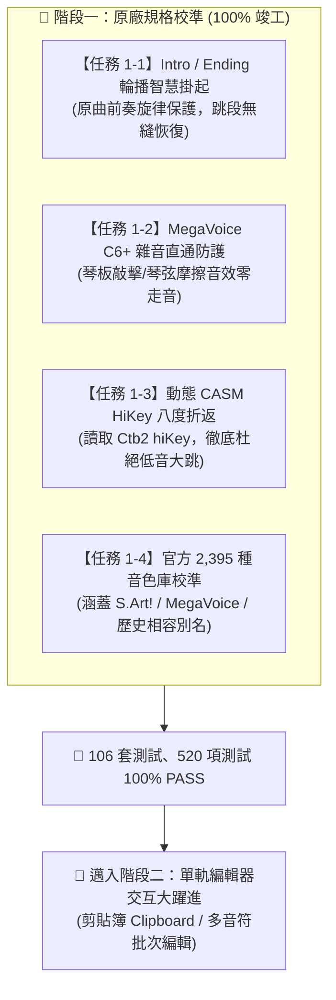

# Yamaha Style Player & Editor 工作成果與跨帳號無縫接軌指南

**紀錄日期**：2026-11-04  
**適用琴型**：Yamaha PSR-SX920 / PSR-SX900 / Genos / Tyros 系列伴奏檔（SFF1 / SFF2）  
**專案儲存庫**：[`Yamaha-Style-Player-Editor`](file:///D:/Vibe%20Coding/Yamaha-Style-Player-Editor)  
**GitHub 雲端**：👉 [https://github.com/CMChen59/Yamaha-Style-Player-Editor](https://github.com/CMChen59/Yamaha-Style-Player-Editor)  
**目前分支**：`main`  
**自動化測試**：**106 個測試套件、520 項測試 100% 綠燈通過 (ALL PASS)**  
**今日里程碑**：**🎯 階段一：原廠規格校準與體驗防呆（Task 1-1 ~ 1-4，共 4 項）100% 全數落實驗收！**

---

## 一、 今日核心進展與技術沉澱 (Phase 1 竣工)

依據專案核心進度總表 [`docs/ROADMAP_AND_EXECUTION_PLAN.md`](file:///D:/Vibe%20Coding/Yamaha-Style-Player-Editor/docs/ROADMAP_AND_EXECUTION_PLAN.md)，階段一「原廠規格校準與體驗防呆」之 4 大關鍵任務已於今日全數開發、測試並整合完成：

### 1. 【任務 1-1】Intro / Ending 輪播智慧掛起防呆 (Smart Progression Suspend)
- **手冊技術依據**：官方《MIDI Song to Style》手冊第 16、26、32 頁規範，Intro 與 Ending 段落帶有原曲旋律與調性，不應被動態伴奏和弦隨意變形。
- **實作成果**：
  - 切換至 `Intro A~C` 或 `Ending A~C` 時，系統自動掛起「多小節自動輪播」，維持單一基準調（C）。
  - 畫面上方即時顯示溫馨提示條：「🎵 目前為前奏/尾奏段落，已自動維持原調以保護原曲旋律」。
  - 切回 `Main A~D` 或 `Fill In` 時，自動無縫接續使用者設定的多小節和弦輪播。
  - 單元測試：`tests/smart-progression-suspend.test.ts` (8 項測試全數通過)。

### 2. 【任務 1-2】MegaVoice C6 (Pitch ≥ 96) 全音軌雜音直通防護
- **手冊技術依據**：手冊第 31 頁《Hi Zone Mega Voice》明確載明：C6 以上為專屬吉他摩擦、敲板、滑弦噪聲，嚴禁轉調。
- **實作成果**：
  - 在 `ChordTransposer.transposeSingleNote` 核心入口建立 MegaVoice 噪聲隔離閥：凡音色標記為 MegaVoice 且音高 ≥ 96 之音符，一律直通回傳原音。
  - 單元測試：`tests/megavoice-c6-protection.test.ts` (177 行測試全數通過)。

### 3. 【任務 1-3】動態 CASM HiKey 轉調八度折返決策
- **手冊技術依據**：手冊第 30~31 頁規範各軌 CASM 擁有獨立的 `hiKey (0~11)`，作為目標和弦根音向下翻八度（-12）的折返臨界點。
- **實作成果**：
  - 徹底告別過去硬編碼的 F# (6) 假定，優先讀取二進位 CASM `Ctb2` 結構中的原廠 `hiKey`。
  - Bass 軌預設為 F (5)，確保貝斯線始終穩健紮實於渾厚低音區，杜絕高八度尖銳怪聲。
  - 單元測試：`tests/casm-hikey-octave-wrap.test.ts` (212 行測試全數通過)。

### 4. 【任務 1-4】官方 2,395 種音色資料庫一致性校驗
- **依據文檔**：官方 `docs/references/psr-sx920/Yamaha_PSR-SX920_VoiceList.txt` (2,478 行) 與 `psrsx920_sx720_dl_zh_a0.xlsx` Data List。
- **實作成果**：
  - 補齊並校準全數 2,395 款 PSR-SX920 原廠音色之 MSB / LSB / PC 與官方前綴（`S.Art!`, `Live!`, `Cool!`, `Sweet!`, `MegaVoice`, `Drums`, `Legacy`）。
  - 建立 `LEGACY_VOICE_ALIASES` 三聯號別名對照表，完美相容前代琴型舊伴奏檔案。
  - 單元測試：`tests/sx920-voice-db-consistency.test.ts` (124 行測試全數通過)。

---

## 二、 核心參考規範備忘

所有原廠規格文件均已安全歸檔至儲存庫中，方便隨時查閱比對：
- **文檔總覽手冊**：[`docs/references/README.md`](file:///D:/Vibe%20Coding/Yamaha-Style-Player-Editor/docs/references/README.md)
- **核心執行藍圖**：[`docs/ROADMAP_AND_EXECUTION_PLAN.md`](file:///D:/Vibe%20Coding/Yamaha-Style-Player-Editor/docs/ROADMAP_AND_EXECUTION_PLAN.md)
- **實戰問答庫**：[`docs/USER_QA_KNOWLEDGE_BASE.md`](file:///D:/Vibe%20Coding/Yamaha-Style-Player-Editor/docs/USER_QA_KNOWLEDGE_BASE.md)
- **原廠手冊**：
  - `docs/references/manuals/MIDI_song_to_style_OM_En_A0.pdf`
  - `docs/references/manuals/MIDI_song_to_style_v120_SM_En_A0.pdf`
- **原廠音色與資料清單**：
  - `docs/references/psr-sx920/Yamaha_PSR-SX920_VoiceList.txt`
  - `docs/references/psr-sx920/psrsx920_sx720_dl_zh_a0.xlsx`

---

## 三、 測試與代碼庫狀態

- **自動化測試套件**：**106 個測試檔案、520 項測試 100% 全數綠燈通過 (ALL PASS)**。
- **型別檢查**：`tsc --noEmit` 零錯誤。
- **Production Build**：`npm run build` 成功建置。
- **遠端倉庫**：GitHub `main` 分支完全同步，工作區乾淨。

---

## 四、 下一步執行計畫（階段二：單軌編輯器交互大躍進）

階段一原廠規格校準已 100% 完工，緊接著啟動階段二任務：

| 順序 | 任務編號 | 任務名稱與具體規劃 | 預估工時 | 優先級 |
| :--- | :--- | :--- | :---: | :---: |
| **1** | **【任務 2-1】** | **Tier 2-4：樂句剪貼簿 (Clipboard: Copy / Cut / Paste)** - 支援 <kbd>Ctrl+C</kbd>、<kbd>Ctrl+X</kbd>、<kbd>Ctrl+V</kbd> - 跨小節與跨軌道音符精確貼上，維持相對 Tick - 完整整合 Undo/Redo 歷史堆疊 (<kbd>Ctrl+Z</kbd> / <kbd>Ctrl+Y</kbd>) | 1.5 ~ 2 天 | ⭐⭐⭐⭐⭐ (核心) |
| **2** | **【任務 2-2】** | **Tier 2-5：多音符批次編輯面板 (Batch Inspector)** - 框選多顆音符批次力度縮放 (Velocity Scale) - 批次時值長度伸縮 (Gate Time / Duration) - 批次音高移調 (Transpose) | 1.5 ~ 2 天 | ⭐⭐⭐⭐⭐ (高實用) |
| **3** | **【任務 2-3】** | **SFF-GE 吉他琶音與掃弦動態進階微調** - Capo Position 吉他高低把位微調 - 撥片掃弦力度微延遲 (Strum Velocity Gradient) | 1 天 | ⭐⭐⭐ |
