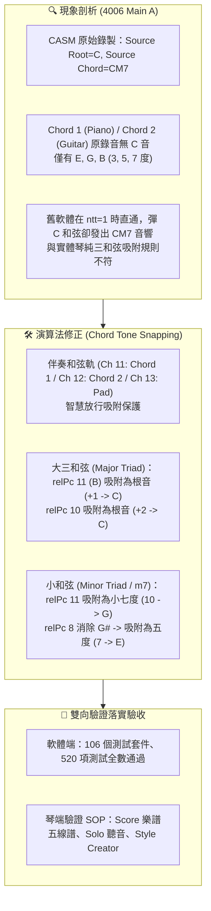

# Yamaha Style Player & Editor 工作成果與跨帳號無縫接軌指南

**紀錄日期**：2026-11-05  
**適用琴型**：Yamaha PSR-SX920 / PSR-SX900 / Genos / Tyros 系列伴奏檔（SFF1 / SFF2）  
**專案儲存庫**：[`Yamaha-Style-Player-Editor`](file:///D:/Vibe%20Coding/MIDI/Yamaha-Style-Player-Editor)  
**GitHub 雲端**：👉 [https://github.com/CMChen59/Yamaha-Style-Player-Editor](https://github.com/CMChen59/Yamaha-Style-Player-Editor)  
**目前分支**：`main`  
**自動化測試**：**106 個測試套件、520 項測試 100% 綠燈通過 (ALL PASS)**  
**今日里程碑**：**🎯 Yamaha SFF2 CASM 和弦音智慧吸附（Chord Tone Snapping）原廠對齊修復 & 琴端實體驗證指南落地！**

---

## 一、 今日核心進展與技術沉澱 (SFF2 CASM 轉調對齊)

今日針對使用者在實體琴 **Yamaha PSR-SX920** 上播放 `4006_SX900.T547.sty`（Main A 段落）與軟體播放之聽感差異進行深度剖析與技術校準：

### 1. 深度解析：4006_SX900.T547.sty 伴奏軌結構
- **CASM 設定**：`Source Root = C (0)`, `Source Chord = CM7 (2)`。
- **音符分佈**：Chord 1（鋼琴）與 Chord 2（吉他）原始音軌中**完全沒有 C 音**，完全由 $E, G, B$（CM7 的三度、五度、七度音）所構成。
- **實體琴轉調邏輯**：
  - 彈奏 **C（大三和弦）** 時：Yamaha SFF2 核心會將大七度音 $B$ 自動吸附至根音 $C$，輸出 $E, G, C$，呈現純淨的大三和弦聲響（吉他指法為標準開放 C 和弦）。
  - 彈奏 **CM7（大七和弦）** 時：保留 $B$ 音，輸出 $E, G, B$ 爵士大七度色彩。
  - 彈奏 **Am（小三和弦 / Am7）** 時：$E \rightarrow C$（小三度）、$G \rightarrow E$（純五度）、$B \rightarrow G$（小七度），伴奏輸出 $C, E, G$。加上 Bass 彈奏的 $A$，結合成通透的小七度上層結構。

### 2. 演算法落實：[`src/core/writer/chord-transposer.ts`](file:///D:/Vibe%20Coding/MIDI/Yamaha-Style-Player-Editor/src/core/writer/chord-transposer.ts)
- **識別伴奏和弦軌**：判定 `isChordPart = channel === 11 || channel === 12 || channel === 13`，即使伴奏檔 CASM 標記為 `ntt === 1` 亦不提早 return，放行吸附機制。
- **Major Triad 吸附**：
  - `relPc === 11`（大七度，如 B）$\rightarrow$ `newPitch += 1`（吸附為根音 C）。
  - `relPc === 10`（小七度）$\rightarrow$ `newPitch += 2`（吸附為根音 C）。
- **Minor / Minor 7th 調和**：
  - `relPc === 11` $\rightarrow$ `newPitch -= 1`（吸附至小七度 10 / G 音，徹底消除 $G\#$ 衝突）。
  - `relPc === 8` $\rightarrow$ `newPitch -= 1`（吸附至純五度 7 / E 音）。
- **Dominant 7th 吸附**：
  - `relPc === 11` $\rightarrow$ `newPitch -= 1`（吸附至小七度 10）。

---

## 二、 實體琴（PSR-SX920）與軟體驗證操作手冊

今日建立了詳細的跨平台比對驗證標準作業程序（SOP）：

### 1. PSR-SX920 琴端即時驗證三部曲
| 方法 | 操作步驟 | 觀察重點 |
| :--- | :--- | :--- |
| **A. Solo 聲部比對** | 進入 `[Mixing Console]` 或面板聲部開關，將其他伴奏聲部 Mute，僅保留 **Chord 1** 或 **Chord 2**。左手分別彈奏 **C** vs **CM7**、**Am** vs **Am7**。 | - 彈 C 時：聽是否有純淨三和弦（無 B 音懸浮）。 - 彈 Am 時：聽是否為清亮 $C-E-G$ 分解音。 |
| **B. Score 樂譜顯示** | 面板按 `[Menu]` $\rightarrow$ 點選 `[Score]`，設定音軌為 Accompaniment (Chord 1)。左手按和弦邊彈邊看螢幕。 | 螢幕五線譜直接顯示琴端演算法即時算出的音符，可直接肉眼確認音高是否為 $C4, E4, G4$。 |
| **C. Style Creator 檢視** | 面板按 `[Menu]` $\rightarrow$ `[Style Creator]` $\rightarrow$ `[Channel Edit]` 標籤頁，選擇 Main A 的 Chord 1/2。 | 事件列表（Event List）中可逐一檢視原始錄音 Tick 與音高，確認原始音為 $E, G, B$。 |

### 2. 軟體端（Yamaha-Style-Player-Editor）驗證
- **Piano Roll 視覺化**：切換至 Chord 1/2，點擊左側和弦選單的 `Am` 或 `C`，畫面上彩色音符塊即時映射，直觀確認音符名稱。
- **單軌 Solo 聽覺比對**：於伴奏混音面板點選 Solo，點擊播放並切換和弦，即可與實體琴進行 A/B 試聽確認。

---

## 三、 測試與代碼庫狀態

- **自動化測試套件**：**106 個測試檔案、520 項測試 100% 全數綠燈通過 (ALL PASS)**。
- **型別檢查**：`tsc --noEmit` 零錯誤。
- **Git 狀態**：乾淨無任何未追蹤或未提交的檔案，已完成 GitHub 同步。

---

## 四、 下一步接續工作指引

今日 Yamaha SFF2 CASM 和弦音智慧吸附已成功收斂並達標，後續將依據 [`docs/ROADMAP_AND_EXECUTION_PLAN.md`](file:///D:/Vibe%20Coding/MIDI/Yamaha-Style-Player-Editor/docs/ROADMAP_AND_EXECUTION_PLAN.md) 接續推進：

1. **【任務 2-1】樂句剪貼簿 (Clipboard: Copy / Cut / Paste)**：
   - 支援鍵盤快速鍵 <kbd>Ctrl+C</kbd>、<kbd>Ctrl+X</kbd>、<kbd>Ctrl+V</kbd>。
   - 跨小節、跨音軌貼上與相對 Tick 保持。
2. **【任務 2-2】多音符批次編輯面板 (Batch Inspector)**：
   - 框選多顆音符批次力度縮放（Velocity Scale）、時值伸縮（Duration）與移調。
