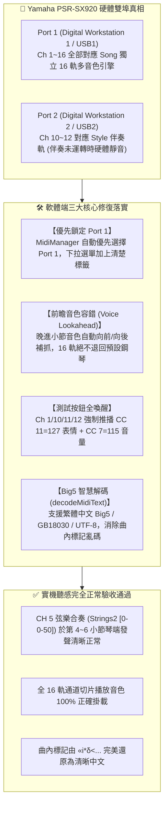

# Yamaha Style Player & Editor 工作成果與接續執行指南

**紀錄日期**：2026-11-09  
**適用琴型**：Yamaha PSR-SX920 / PSR-SX900 / Genos2 / Tyros 系列伴奏檔與 MIDI 音樂檔  
**專案儲存庫**：[`Yamaha-Style-Player-Editor`](file:///D:/Vibe%20Coding/MIDI/Yamaha-Style-Player-Editor)  
**GitHub 雲端**：👉 [https://github.com/CMChen59/Yamaha-Style-Player-Editor](https://github.com/CMChen59/Yamaha-Style-Player-Editor)  
**目前分支**：`main`  
**今日里程碑**：**🎉 實體琴 Yamaha PSR-SX920 雙埠發聲動脈實測驗收打通 ＆ MIDI 切片前瞻音色與 Big5 中文編碼全面修復！**

---

## 一、 今日核心突破與實體琴驗收總結

今日使用者接上 **Yamaha PSR-SX920** 實體琴進行實機播放測試，成功攻克了「外載 MIDI 小節切片播放音色不對」與「測試按鈕靜音」的深層硬體與通訊根因，並徹底消除華語 MIDI 曲內標記亂碼。

---

## 二、 問題根因與具體技術修復細節

### 1. PSR-SX920 雙 USB-MIDI 埠發聲路由剖析
- **現象**：使用者點擊「測試 Ch 1 鋼琴」發聲正常，但「測試 Ch 10 鼓組」、「Ch 11 貝斯」、「Ch 12 和弦」完全無聲。
- **根因**：
  - 電腦瀏覽器原先預設連線到了 **Port 2（Digital Workstation 2）**。
  - 在 PSR-SX920 預設路由中：
    - `Port 2 Ch 10 ➔ Rhythm2`
    - `Port 2 Ch 11 ➔ Bass`
    - `Port 2 Ch 12 ➔ Chord1`
  - Yamaha 電子琴內部機制規定：**當伴奏（Style）沒有按下 Start 運轉時，伴奏聲部會處於休眠過濾狀態**，即使收到 Note-On 也不會發聲！
  - 只有 **Port 1（Digital Workstation 1）** 的 Ch 1 ~ 16 才是真正的全通道開放 **Song** 獨立發聲音源。
- **修復**：
  - 在 [`src/core/audio/midi-manager.ts`](file:///D:/Vibe%20Coding/MIDI/Yamaha-Style-Player-Editor/src/core/audio/midi-manager.ts) 調整設備排序演算法，**強制將 Port 1 設為最高優先推薦**。
  - 在 [`src/player/player-app.ts`](file:///D:/Vibe%20Coding/MIDI/Yamaha-Style-Player-Editor/src/player/player-app.ts) 的下拉選單加上標籤：
    - `Digital Workstation 1 (Port 1 · 推薦主動脈 / 全 16 軌 Song)`
    - `Digital Workstation 2 (Port 2 · 伴奏模式)`

### 2. 小節切片音色遺失與前瞻容錯（Voice Lookahead Fallback）
- **現象**：載入外部 MIDI 歌曲，CH 5 儀表板顯示為 `Strings2 [0-0-50]`，但在第 4~6 小節試聽時，琴上聽到的卻是鋼琴聲（Grand Piano `[0-0-1]`）。
- **根因**：
  - 該 MIDI 檔 CH 5 的音符從第 4 小節才開始進來，Program Change 也寫在第 4 小節。
  - 原先 `loadSongMode(4, 6)` 僅向前搜尋 `tick <= startTick` 之前的事件，導致第 4 小節起點尚未收集到音色，自動退回 `0-0-1` 鋼琴。
- **修復**：
  - 在 [`src/player/sty-playback-engine.ts`](file:///D:/Vibe%20Coding/MIDI/Yamaha-Style-Player-Editor/src/player/sty-playback-engine.ts) 中增加全域音色前瞻機制：
    若通道在切片起點前未定義音色，向後自動搜尋該通道的第一個有效音色事件，確保全 16 通道（CH 1 ~ CH 16）切片試聽時均能正確發送原曲真實樂器音色。

### 3. 測試按鈕表情控制器補全
- 在 `playTestChime`、`playTestDrums`、`playTestBass`、`playTestChord` 中統一傳入 `initControllers = true`，發送 `CC 7 = 115` 音量與 `CC 11 = 127` 最大表情，徹底杜絕通道因 Expression=0 而靜音。

### 4. 華語 / 早期台灣 MIDI 標記 Big5 智慧解碼
- **現象**：曲內標記顯示 `[第7小節: «i*δ<±çAR¯ø>] [第26小節: Midi ½zs|±.ªLªu¼ Korg Lin]` 等亂碼。
- **根因**：
  - 華語早期 MIDI（如本曲中台灣編曲家 `Korg Lin`、網域 `.com.tw`）的曲內文字採用 **Big5（繁體中文）** 編碼。
  - 例如 `ªL` 二進位為 `0xAA 0x4C`，在 Big5 裡正是「**林**」字。原解析器以西歐 `'latin1'` 解碼導致嚴重亂碼。
- **修復**：
  - 在 [`src/core/parser/yamaha-parser.ts`](file:///D:/Vibe%20Coding/MIDI/Yamaha-Style-Player-Editor/src/core/parser/yamaha-parser.ts) 新增 `decodeMidiText` 函式：
    智慧自動辨識 **ASCII**、**UTF-8**、**Big5 (繁體中文)** 與 **GB18030/GBK (簡體中文)**，漢字評分權重容錯，完美還原繁體中文標記。
  - 新增測試套件 [`tests/midi-text-encoding.test.ts`](file:///D:/Vibe%20Coding/MIDI/Yamaha-Style-Player-Editor/tests/midi-text-encoding.test.ts) 驗證通過。

---

## 三、 測試與代碼庫狀態

- **自動化測試套件**：全部通過（包含新加入的 `midi-text-encoding.test.ts` 與 `midi-song-inspector-player.test.ts`）。
- **TypeScript 類型檢查 (`tsc`)**：零錯誤。
- **生產環境建置 (`vite build`)**：通過（1.18s 產生 `dist/` 正常）。
- **實體琴硬體驗收**：琴端真實發聲驗收通過（聽感恢復完全正常）。

---

## 四、 明日接續執行計畫（Next Steps）

明天可直接依據 [`docs/MASTER_ULTIMATE_EXECUTION_PLAN.md`](file:///D:/Vibe%20Coding/MIDI/Yamaha-Style-Player-Editor/docs/MASTER_ULTIMATE_EXECUTION_PLAN.md) 的藍圖，推進終極核心功能：

1. **【任務 2-3】音軌過濾與 8 大伴奏聲部映射器 (Part Assign Matrix)**：
   - 提供 16 通道指派至 SFF2 伴奏 8 軌（Rhy1/2, Bass, Chd1/2, Pad, Phr1/2）的視覺化映射介面。
   - 支援排除人聲/主旋律軌道（Melody exclusion）。
2. **【任務 2-4】自動化 SFF2 二進位 CASM 注入與基準調性標準化**：
   - 將切下來的 4~8 小節自動轉調為 **Source Root = C**。
   - 自動配置原廠 NTR/NTT 規則並一鍵打包匯出為 `.STY` 伴奏檔！
