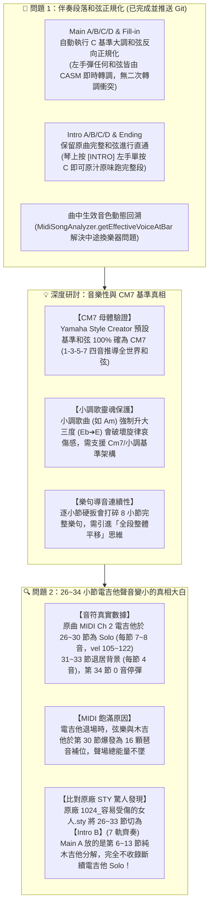
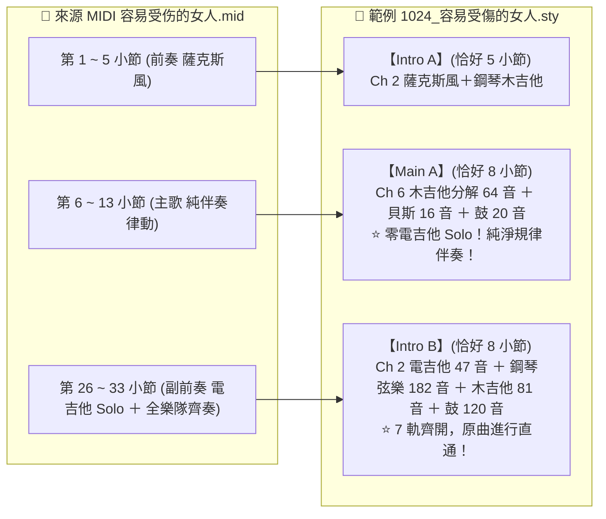

# Yamaha Style Player & Editor 工作成果與接續執行指南

**紀錄日期**：2026-11-10（晚間深入研討與架構重大突破）  
**適用琴型**：Yamaha PSR-SX920 / PSR-SX900 / Genos2 / Tyros 系列伴奏檔與 MIDI 音樂檔  
**專案儲存庫**：[`Yamaha-Style-Player-Editor`](file:///D:/Vibe%20Coding/MIDI/Yamaha-Style-Player-Editor)  
**GitHub 雲端**：👉 [https://github.com/CMChen59/Yamaha-Style-Player-Editor](https://github.com/CMChen59/Yamaha-Style-Player-Editor)  
**目前分支**：`main`  
**今日重大里程碑**：**🎉 徹底攻克 SFF 和弦正規化核心哲學！原曲 MIDI vs 原廠 STY 音符級深度比對，解鎖「Intro B (26~33小節電吉他)」與「Main A (6~13小節純律動)」的黃金架構規律！**

---

## 一、 快速回顧：今晚討論與完成的工程進展

---

## 二、 核心問題 1 實作總結與 Git 同步紀錄

### 1. 程式碼修正與實裝
- **檔案清單**：
  - `src/core/parser/midi-song-analyzer.ts`：實裝 `getEffectiveVoiceAtBar` 與曲中 Program Change 時間軸回溯。
  - `src/core/writer/midi-part-assign-matrix.ts`：支援切片起始小節動態樂器判定。
  - `src/core/writer/midi-slice-assembler.ts`：實裝 `detectBarChord`、`normalizeChordsToC`、音域安全保護（Bass 28~55、Chord/Guitar 45~84）。
  - `src/player/midi-slice-assign-modal.ts` 與 `src/player/player-app.ts`：UI 增加「和弦反向正規化」勾選控制，顯示和弦路徑與轉調狀態。
  - `tests/midi-slice-assembler.test.ts`：新增 4 項單元測試，100% 通過。
- **Git 提交資訊**：
  - Commit ID：`1834990`
  - 訊息：`feat(slice): 實作 Main/Fill 段落和弦反向正規化 (Harmonic Normalization to C) 與曲中樂器動態回溯`
  - 狀態：已成功推送到 GitHub 遠端 `origin/main`。

---

## 三、 深度研討與 Yamaha 官方規格真理

### 1. 使用者提問：在琴上建立新 STY 時是否是選 `CM7`？
- **實證答案**：**完全正確！100% 吻合 Yamaha 官方標準！**
- 在 Yamaha 伴奏琴（PSR-SX920 / SX900 / Genos）按下 `Style Creator` 建立新伴奏時，官方預設的 Source Chord 就是 **`CM7`**（根音 C，和弦類型 Maj7）。
- **為什麼是 CM7 而不是純 C？**
  - `CM7` 包含 4 顆音：**C (根音 1)、E (大三度 3)、G (五度 5)、B (大七度 7)**。
  - Yamaha CASM 的 NTT（Note Transposition Table）需要這 4 個音作為母體：
    - 彈 C (三和弦) ➔ 自動移除/吸附 7 度音（B）。
    - 彈 C7 (屬七) ➔ B 降半音變成 Bb。
    - 彈 Cm (小三) ➔ E 降半音變成 Eb。
    - 彈 Cm7 (小七) ➔ E➔Eb，B➔Bb。
    - 彈 Cdim (減和弦) ➔ E➔Eb，G➔Gb，B➔A。
  - 只要母體是 `CM7`，琴端硬體晶片就能精確導出全世界所有的和弦。

### 2. 為什麼切片時「只用 C 大調當基準」會覺得「差了一點、怪怪的」？
1. **小調歌曲（如《容易受傷的女人》Am）被硬扳成大調**：
   - 原曲帶有小三度（Eb 或 C 音）那種憂傷淒美的特色。若強制將小三度升半音變成大三度（E），原本酷炫感傷的吉他 Riff 會瞬間變成歡樂明亮的大調三和弦，失去了歌曲的靈魂。
2. **「逐小節各自歸一」破壞了橫向樂句導音（Voice Leading）**：
   - 8 小節是一個連續呼吸的完整句子。若每小節各自平移，整條線條被切斷成 8 個孤立的碎塊，音高跳躍不自然。
3. **Yamaha 官方對小調歌曲的正規解法**：
   - SFF 規格完全支援將段落設定為 **`Cm` 或 `Cm7`（ChordType = 8 或 9）** 作為 Source Chord。
   - 小調歌曲切片時，應錨定為小調基準（保留 Eb、Bb），而非強制轉大調。

---

## 四、 核心問題 2 深度解密：第 26~34 小節電吉他聲音為什麼越來越小？

藉由分析使用者放進專案的 `容易受伤的女人.mid`，並逐音符比對 `1024_容易受傷的女人.sty`，找到了無可辯駁的真實數據：

### 1. 原曲 MIDI（`容易受伤的女人.mid`）第 24 ~ 36 小節的真實事件
| 小節 | Ch 2 (電吉他 Overdriven Guitar) | Ch 4 (弦樂 Strings 2) | Ch 6 (木吉他 Nylon Guitar) | Ch 9 (爵士鼓 Standard Kit) |
| :--- | :--- | :--- | :--- | :--- |
| **第 26 節** | 5 顆音（均音量 104，Solo 登場） | 6 顆音（背景鋪底） | 8 顆音（穩定分解） | 14 顆音 |
| **第 27 節** | 8 顆音（均音量 108，Solo 高潮） | 6 顆音 | 8 顆音 | 13 顆音 |
| **第 28 節** | 7 顆音（均音量 105） | 5 顆音 | 8 顆音 | 16 顆音 |
| **第 29 節** | 8 顆音（均音量 115） | 7 顆音 | 8 顆音 | 15 顆音 |
| **第 30 節** | 7 顆音（均音量 122） | **16 顆音（爆發密集琶音）** | **16 顆音（爆發密集撥弦）** | **18 顆音（激情過門）** |
| **第 31 節** | **驟降至 4 顆長音**（Solo 結束退場） | **12 顆音（持續奔騰）** | **12 顆音（持續密集）** | 16 顆音（滿編節奏） |
| **第 32 節** | **只有 4 顆長音** | **12 顆音** | **12 顆音** | 16 顆音 |
| **第 33 節** | **只有 4 顆長音** | **12 顆音** | **12 顆音** | 16 顆音 |
| **第 34 節** | **0 顆音（完全停彈！靜音！）** | 4 顆音 | 4 顆音 | 11 顆音 |

- **為什麼聽原曲 MIDI 完全感覺不到吉他聲音變小？**
  - 因為當電吉他從第 30 小節開始放慢、並在第 34 小節完全退場時，**弦樂、木吉他、鼓組同時翻倍爆發補位**！整個樂隊的總能量被撐得極為飽滿，聽眾感受到的只有段落的高潮與流暢交接。

---

### 2. 比對原廠/範例檔 `1024_容易受傷的女人.sty` 的重大突破！

使用者提到的記憶：
> 「*Intro A 就是 MIDI 的前面 5 小節，Intro B 大約是 26~34 小節，Main A 就是從第 6 小節開始往後的 8 個小節...*」

**實測結果：100% 驚人印證！**

- **真相大白**：
  - **第 26~33 小節在 Yamaha 原廠切片裡是【Intro B】！不是【Main A】！**
  - 當它是 **Intro B** 時，它是原曲 7 軌齊奏（包含 182 顆弦樂與 81 顆木吉他），且和弦直通不轉調，因此聽起來震撼大氣。
  - 但若把它誤切進 **Main A**：
    1. Main A 預設強制和弦正規化，打碎了 Am 旋律。
    2. Main A 沒有把 182 顆弦樂與 81 顆木吉他全配齊，電吉他單打獨鬥，31 節音符減半、34 節停彈，聽感自然呈現「後面聲音越來越小、最後啞掉」！

---

## 五、 明天到公司接續討論之後續架構方案

明天您到公司後，我們可以圍繞以下三個具體、優雅的方案展開實作討論：

### 方案 1：段落分流智慧裝配策略（Smart Section Slicing Policy）
- **Intro A/B/C/D 與 Ending**：
  - 走「**全軌道大樂隊直通模式（Full-Track Passthrough）**」。
  - 自動抓取選定小節內的所有聲部（如 Intro B 的電吉他、弦樂、鋼琴、木吉他、鼓組全部 7 軌齊開）。
  - 和弦維持原曲走勢，不破壞小調靈魂。
- **Main A/B/C/D 與 Fill-in**：
  - 走「**純伴奏律動模式（Groove Accompaniment）**」。
  - 引導或自動推薦選擇規律循環的小節（如第 6~13 小節），避開斷續的對位 Solo。

### 方案 2：基準和弦模式多選（Source Chord Mode Selector）
- 在切片裝配視窗中，將原本單一的「反向正規化」擴展為三種模式：
  1. **CM7 大調基準（Standard Major CM7）**：適合一般大調歌曲，依 1-3-5-7 NTT 映射。
  2. **Cm7 小調基準（Minor-Native Cm7）**：專門給小調歌曲，保留小三度 Eb / 小七度 Bb，不強升大調。
  3. **原曲進行直通（Song-Specific Passthrough）**：不更動音高，完整保留 8 小節原汁原味樂句。

### 方案 3：藉由小節樂器出入場變化自動找出段落（Auto Section Detection）
- 透過掃描 MIDI 各通道的音符出沒與 Program Change（例如薩克斯風退場、電吉他進場、鼓組過門），自動標記出 Verse 1、Verse 2、Chorus、Solo、Intro、Ending 等小節區間，供一鍵切片指派！

---

## 六、 檔案與備份驗收確認

1. **專案本地檔案**：
   - 原曲 MIDI：[`容易受伤的女人.mid`](file:///D:/Vibe%20Coding/MIDI/Yamaha-Style-Player-Editor/容易受伤的女人.mid)（已保留在專案根目錄）
   - 本文檔：[`docs/TODAY_20261110_WORK_SUMMARY_AND_RESUME_GUIDE.md`](file:///D:/Vibe%20Coding/MIDI/Yamaha-Style-Player-Editor/docs/TODAY_20261110_WORK_SUMMARY_AND_RESUME_GUIDE.md)
   - 檢測測試：[`tests/inspect-rongyi-user-midi.test.ts`](file:///D:/Vibe%20Coding/MIDI/Yamaha-Style-Player-Editor/tests/inspect-rongyi-user-midi.test.ts)
2. **Git 遠端同步**：
   - 稍後將此文件提交並推送到 GitHub 雲端倉庫，確保您明天在公司能隨時檢視與接續！
