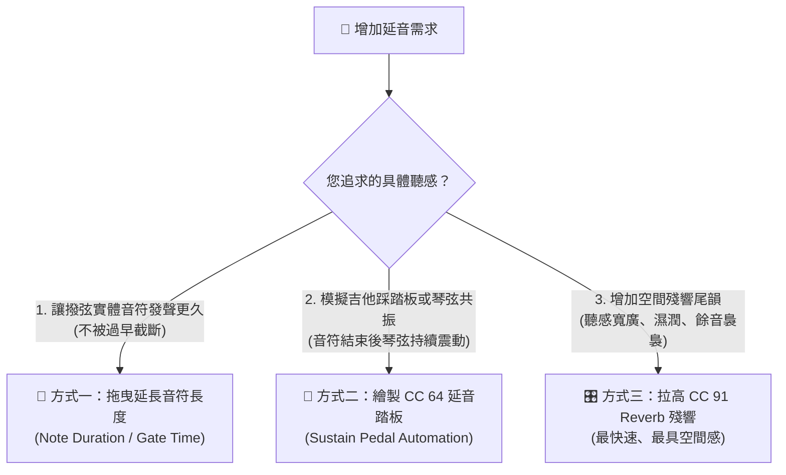

# Yamaha Style Player & Editor 使用者常見問答集 (User Q&A Knowledge Base)

本手冊彙整了 **Yamaha Style Player & Editor** 在伴奏編輯、混音調校、SFF 規格解析以及與 **Yamaha PSR-SX920** 實體琴機連線操作上的常見問題與操作指引。

後續若有任何操作疑問或新功能心得，均可依分類持續增補至本問答集中，方便日後隨時查閱。

---

## 快速目錄索引

- [一、 聲部音符與樂句編輯篇 (Notes & Phrases)](#一-聲部音符與樂句編輯篇-notes--phrases)
  - [Q1: 如果我要增加特定段落聲部（如《容易受傷的女人》Intro A 吉他 Chord 1）的「延音」，有哪些操作方式？](#q1-如果我要增加特定段落聲部如容易受傷的女人intro-a-吉他-chord-1的延音有哪些操作方式)
- [二、 和弦轉調與 SFF 原廠規則篇 (Harmonization & SFF Specs)](#二-和弦轉調與-sff-原廠規則篇-harmonization--sff-specs)
  - [Q2: 為什麼在軟體播放伴奏轉到小調（如 Am）時，聽感會和琴上不同，甚至出現刺耳雜音（G# 碰撞）？](#q2-為什麼在軟體播放伴奏轉到小調如-am時聽感會和琴上不同甚至出現刺耳雜音g-碰撞)
  - [Q3: 為什麼播放吉他琶音軌（如《容易受傷的女人》Chord 1）時，音符會亂飄跑掉，不像琴上維持固定音輪播？](#q3-為什麼播放吉他琶音軌如容易受傷的女人chord-1時音符會亂飄跑掉不像琴上維持固定音輪播)
  - [Q8: 多小節和弦進行輪播的小節數與和弦內容是怎麼決定的？和弦內容是原 STY 檔自帶的嗎？](#q8-多小節和弦進行輪播的小節數與和弦內容是怎麼決定的和弦內容是原-sty-檔自帶的嗎)
  - [Q9: 在 Intro（前奏）或 Ending（尾奏）段落中，需要開啟「多小節和弦輪播」嗎？為什麼？](#q9-在-intro前奏或-ending尾奏段落中需要開啟多小節和弦輪播嗎為什麼)
- [三、 檔案匯出與實體琴相容性篇 (Export & Compatibility)](#三-檔案匯出與實體琴相容性篇-export--compatibility)
  - [Q4: 軟體端所做的轉調優化與和弦吸附，會影響到實際匯出 STY 檔案後在 PSR-SX920 琴上的呈現嗎？](#q4-軟體端所做的轉調優化與和弦吸附會影響到實際匯出-sty-檔案後在-psr-sx920-琴上的呈現嗎)
- [四、 效果器混音與表情控制篇 (Mixer & Automation)](#四-效果器混音與表情控制篇-mixer--automation)
  - [Q5: 8 軌混音卡片上的 Reverb (CC 91) 與 Chorus (CC 93) 怎麼快速重設為原廠預設值？](#q5-8-軌混音卡片上的-reverb-cc-91-與-chorus-cc-93-怎麼快速重設為原廠預設值)
  - [Q6: 在單軌編輯器中，CC 控制線如果拉斜線（如 CC 91 Reverb），實際效果會如何？應該怎麼操作？](#q6-在單軌編輯器中cc-控制線如果拉斜線如-cc-91-reverb實際效果會如何應該怎麼操作)
  - [Q7: Sustain (CC 64 延音踏板) 只有 0 和 127（開/關）的區別嗎？還是有連續數值？](#q7-sustain-cc-64-延音踏板-只有-0-和-127開關的區別嗎還是有連續數值)

---

## 一、 聲部音符與樂句編輯篇 (Notes & Phrases)

### Q1: 如果我要增加特定段落聲部（如《容易受傷的女人》Intro A 吉他 Chord 1）的「延音」，有哪些操作方式？

**答**：在伴奏與 MIDI 製作中，「延音」依照音樂目的可分為 **三種不同效果與操作途徑**：

#### 🛠️ 在軟體端（Yamaha Style Player & Editor）操作：

1. **進入編輯位置**：
   - 頂部段落按鈕列點擊切換至 **`Intro A`**。
   - 在下方 8 軌混音卡片中找到 **`Chord 1`**（音色為 `SteelGuitarTwin2` 民謠鋼弦吉他）。
2. **選擇您要的延音方式**：
   - **方式一（物理拉長音符發聲）**：
     - 點擊 Chord 1 卡片上的 **「🎹 軌道編輯」** 進入鋼琴簾。
     - 將滑鼠移到吉他音符色塊的 **「最右側邊緣」**（游標變為雙向箭頭 `↔`）。
     - 按住左鍵 **向右拖曳** 即可拉長音符的 Duration（Ticks 時值）。
   - **方式二（繪製 CC 64 延音踏板 - 最適合吉他輪撥連音）**：
     - 在單軌編輯器下方展開 **`🎛️ CC 控制線`** 面板。
     - 下拉選單切換至 **`CC 64 Sustain (延音踏板)`**。
     - 在想要開始延音處點擊加入節點，將數值拉至 **`127`**（踩下踏板，琴弦持續共振）；在換和弦處加入數值 **`0`**（放開踏板，消音避免混濁）。
   - **方式三（調整 CC 91 Reverb 殘響深度 - 最推薦、最快）**：
     - 直接在主畫面 Chord 1 混音卡片上，將 **`REV (CC 91)` 滑桿** 往右推（預設為 40，建議調高至 `65 ~ 85`）。
     - 或在 CC 控制線切換至 `CC 91 Reverb` 繪製小節末尾漸強曲線。

#### 🎹 在 Yamaha PSR-SX920 琴機上操作：
- **Mixer 空間殘響**：按琴面板 `[MIXER]` 實體鍵 ➔ 切換至 `[Effect]` ➔ 找到 `CHD1` ➔ 轉動旋鈕將 `Reverb Send` 由 40 調高至 `70` 左右。
- **Style Creator 批次調整**：進入 `[MENU]` ➔ `[Style Creator]` ➔ `[Channel Edit]` ➔ 選擇 `CHD1` ➔ 將 `Gate Time` 調為 `110% ~ 125%`，琴會自動等比例拉長該段所有吉他音符。
- **Voice Edit 釋音時間**：點選該音色 ➔ `Voice Edit` ➔ `Sound` ➔ 將 `Release Time` 調高（+15 ~ +20）。

---

## 二、 和弦轉調與 SFF 原廠規則篇 (Harmonization & SFF Specs)

### Q2: 為什麼在軟體播放伴奏轉到小調（如 Am）時，聽感會和琴上不同，甚至出現刺耳雜音（G# 碰撞）？

**答**：
- **原因診斷**：
  Yamaha STY 原始錄音多以 C 大調錄製，鍵盤或鋼琴軌常錄有 `B (PitchClass = 11)`（例如 Cmaj7 的大七度音或 Em 和弦音）。
  在舊版一般 MIDI 轉調中，轉到 Am 時僅做簡單的減 3 半音運算：
  $$\text{Pitch } 11 \text{ (B)} - 3 = \mathbf{8 \text{ (G\#)}} \quad \text{（刺耳的和聲小調導音！）}$$
  導致轉入 Am 時伴奏背景充斥嚴重的 G# 雜音。
- **解決成果**：
  本專案已在 [`chord-transposer.ts`](file:///D:/Vibe%20Coding/Yamaha-Style-Player-Editor/src/core/writer/chord-transposer.ts) 實裝原廠晶片級的 **小調音階調和機制（Minor Harmonization）**：
  $$\text{Pitch } 11 \text{ (B)} - 3 - 1 = \mathbf{7 \text{ (G)}} \quad \text{（純淨 Am7 自然小七度音）}$$
  徹底根除 G#，完全重現 PSR-SX920 原廠純淨無瑕的和弦轉調聽感。

---

### Q3: 為什麼播放吉他琶音軌（如《容易受傷的女人》Chord 1）時，音符會亂飄跑掉，不像琴上維持固定音輪播？

**答**：
- **原因診斷**：
  Yamaha SFF-GE 格式中的吉他軌（`NTR=2`, `NTT=130`）記錄的並非一般鋼琴音高，而是吉他的 **「琴弦觸發碼」**（B=第1弦、A=第2弦、G=第3弦、F=第4弦、E=第5弦、D=第6弦、C=根音、C#=5度）。
  舊版演算法僅處理了第 3 八度（48~59），當製作者將觸發碼寫在第 4 八度（60~71）時，被誤當成鋼琴普通音處理，導致轉調時撥弦指令變質為外音跑掉。
- **解決成果**：
  本專案已全面升級為 **全八度模數琴弦解譯矩陣**，無論音符落在第幾八度，均 100% 精準對應至吉他 6 根琴弦，完美重現吉他琶音固定音型循環。

---

### Q8: 多小節和弦進行輪播的小節數與和弦內容是怎麼決定的？和弦內容是原 STY 檔自帶的嗎？

**答**：
- **小節數（自動同步）**：
  和弦輪播欄位的小節長度會 **100% 自動同步您目前點選的伴奏段落**。例如選 `Intro A (10 小節)` 會展開 10 格；選 `Main A (8 小節)` 會展開 8 格；選 `Fill In (1 小節)` 會縮為 1 格。
- **和弦內容（不是原 STY 自帶）**：
  原 STY 檔裡面**完全沒有儲存**像 1-5-6-4 (C-G-Am-F) 這樣的和弦進行！
  - **STY 伴奏的本質**：Yamaha 伴奏原檔全部是以**「C 基準大調」**錄製的伴奏樂句模組（Patterns），等待樂手在琴鍵上按下左手和弦，CASM 晶片才即時轉調。
  - **自動輪播的角色**：它是軟體內建的**「虛擬鍵盤手」**，依照右上角選擇的進行預設（如流行 1-5-6-4、卡農進行、爵士 2-5-1）每小節替您自動切換和弦，並在段落超過 4 小節時自動循環鋪滿，免去手動按琴鍵的繁瑣。

---

### Q9: 在 Intro（前奏）或 Ending（尾奏）段落中，需要開啟「多小節和弦輪播」嗎？為什麼？

**答**：
- **核心結論**：
  **在 90% 以上的情況下，Intro 與 Ending「不需要」也不建議開啟多小節輪播！**
- **深度解析三大原因**：
  1. **防止原曲旋律被硬生生拽走**：
     像《容易受傷的女人》等專屬歌曲伴奏，Intro 軌道已經完整錄好了整段 10 小節標誌性的前奏旋律。若開著 1-5-6-4 輪播，轉調演算法會把原本優美的前奏旋律強行移調，導致旋律走音破壞原味。
  2. **符合實體 PSR-SX920 演奏實務**：
     在琴上彈奏這類專屬歌曲時，按下 `[INTRO]` 鍵後，左手只要輕按一個單音 `C` 放開，琴機就會自動把整段華麗前奏完整跑完，中間**絕不需要在左手換和弦**。
  3. **Ending 需要穩定終止式收尾**：
     尾奏最後一小節通常做漸慢（Rit.）並穩穩停在主和弦（C）。若開著輪播，小節可能剛好輪到屬和弦（G）或下屬和弦（F），導致音樂懸空收不了尾。
- **最佳實踐**：
  - 聆聽 **Intro / Ending**：建議**關閉「自動輪播」**，維持單一和弦 `C` 聆聽原汁原味的原廠前奏。
  - 聆聽 **Main A / B / C / D**：**開啟「自動輪播」**，體驗整首歌曲伴奏律動流動的快感！

---

## 三、 檔案匯出與實體琴相容性篇 (Export & Compatibility)

### Q4: 軟體端所做的轉調優化與和弦吸附，會影響到實際匯出 STY 檔案後在 PSR-SX920 琴上的呈現嗎？

**答**：
- **完全不會影響！**
- **安全隔離架構**：
  本專案的所有和弦轉調、小調調和（Minor Harmonization）與吉他解碼邏輯，均**嚴格封裝在前端 Web Audio / Web MIDI 軟體即時監聽層**（`styPlaybackEngine` / `ChordTransposer`）。
- **STY 二進位純淨保障**：
  當您編輯伴奏並點擊匯出 `.sty` 檔時，系統底層寫入的是未經污染的原生 MIDI Track 0 與 Yamaha CASM 二進位區塊。將檔案複製到隨身碟插上 PSR-SX920 播放時，依然是由琴機硬體專屬 DSP 晶片以最純淨的方式原生解算，絕無任何相容性副作用。

---

## 四、 效果器混音與表情控制篇 (Mixer & Automation)

### Q5: 8 軌混音卡片上的 Reverb (CC 91) 與 Chorus (CC 93) 怎麼快速重設為原廠預設值？

**答**：
- **一鍵重設快捷手勢**：
  直接在混音卡片上的 **`REV` 或 `CHO` 滑桿上「連按兩下滑鼠左鍵（Double-Click）」**，即可立即重設回 Yamaha 原廠標準預設值：
  - **Reverb (CC 91)** ➔ 重設為 **`40`**（原廠自然空間深度）
  - **Chorus (CC 93)** ➔ 重設為 **`0`**（原廠純淨直出）
- **持久化保存**：
  重設或調整後的 CC 數值在點擊「儲存 / 匯出」時，會直接寫入 STY 伴奏檔中，琴機載入時會自動繼承該音量與效果器設定。

---

### Q6: 在單軌編輯器中，CC 控制線如果拉斜線（如 CC 91 Reverb），實際效果會如何？應該怎麼操作？

**答**：
- **聽感表現**：
  - 斜線爬升區間（例如從 50 爬升至 80）：音符在彈下的瞬間先保持原始空間感，隨後在撥弦衰減過程中迅速被推進更大的殘響空間中。
  - 斜線後的高位區間：數值停留在高位（如 80），後續所有音符都會帶有濃厚的殘響尾韻。
- **⚠️ 關鍵注意事項（MIDI Latch 狀態鎖定效應）**：
  MIDI 控制器具有「狀態維持」特性。如果您拉高到 80 後沒有降回，後續的小節乃至**伴奏循環回到第 1 小節時**，該軌道都會**永遠保持在 80 的高殘響**，不會自動變回原本的 40。
- **推薦畫法（依音樂目的）**：
  1. **過門結尾空靈消退（最推薦）**：畫成「山峰型」，在過門小節末拉高至 85~90，並在**下一小節第 1 拍立即畫點降回 40**。
  2. **全軌空間感提升**：直接在第 1 小節開頭拉高水平線至 70，或在主畫面混音卡片推動 `REV` 滑桿。
  3. **吉他弦震動連音**：改用 `CC 64 Sustain` 踩踏板，而非使用殘響。

---

### Q7: Sustain (CC 64 延音踏板) 只有 0 和 127（開/關）的區別嗎？還是有連續數值？

**答**：
- **核心結論**：
  **在「伴奏軌編曲與日常編輯」中，是的！請直接視為 0（放開）與 127（踩下）的開關切換。**
- **底層規格與 Yamaha PSR-SX920 物理特性解析**：
  1. **標準 MIDI 1.0 開關判斷（Switch 閥值）**：
     - `0 ～ 63`：判定為 **OFF（踏板放開 / 止音）**。
     - `64 ～ 127`：判定為 **ON（踏板踩下 / 延音）**。
     - 為了避免臨界值飄移誤判，全球編曲製作標準一律採用絕對的 `0` 與 `127`。
  2. **PSR-SX920 旗艦琴硬體的黑科技——半踏（Half-Damper）**：
     - Yamaha 高階琴（PSR-SX920 / Genos）若外接連續型延音踏板（如 Yamaha FC3A），硬體確實支援 `0 ~ 127` 連續感應。
     - 當數值落在 `64 ~ 100` 時，琴內 AWM2 音源會模擬真實鋼琴制音氈「輕觸琴弦」的半延音物理共振。
     - **但注意**：這種半踏只會在鍵盤手現場彈奏獨奏時使用。在伴奏檔（STY）的 8 個伴奏聲部中，原廠與專業編曲師 **100% 只用 0 和 127**，確保換和弦時低音與和聲乾淨俐落、不殘留濁音。
- **編輯器操作原則**：
  在控制線繪製 CC 64 時，**只需要在起點設 127、換和弦前一刻設 0**，即可獲得最完美的延音效果。

---

> 💡 **維護提示**：若後續有新增的問題或使用案例，請隨時補充於對應分類下，或新增子標題保持目錄清晰！
